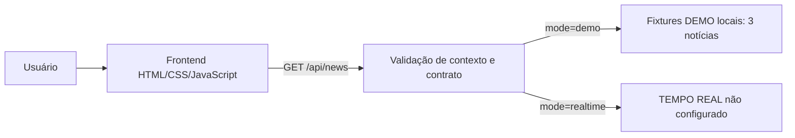

# ARI NEWS

Aplicação demonstrativa de inteligência de negócios baseada na apresentação estruturada de notícias. O projeto reúne uma interface web e um backend local para demonstrar organização de dados, validação de contratos e uma experiência de consulta reproduzível sem serviços externos no modo DEMO.

## Demonstração

O usuário informa setor, região e data no painel. No modo DEMO, a aplicação apresenta um contexto de consulta e exatamente três notícias demonstrativas em cards, com título, fonte, data, resumo e links.

<!-- Inserir futuramente a visão geral da interface no modo DEMO: docs/images/demo-overview.png -->
<!-- Inserir futuramente a captura com os três cards demonstrativos: docs/images/demo-three-cards.png -->

## Problema e solução

Painéis de inteligência de negócios precisam transformar informações em uma leitura rápida e contextualizada. O ARI NEWS aborda essa necessidade com uma interface que organiza notícias por setor, região e data, preservando um contrato de dados claro e uma apresentação consistente.

Para tornar a demonstração segura e reproduzível, o projeto usa fixtures locais em vez de busca externa. Assim, o fluxo pode ser avaliado sem credenciais, APIs ou dependências de rede para carregar os dados do painel.

## Modos de funcionamento

### DEMO

Funciona localmente sem API externa e apresenta exatamente três notícias demonstrativas, fornecidas por fixtures locais e versionadas. Esses dados **não representam notícias atuais** nem resultados de busca em tempo real.

As URLs de fonte usam o domínio reservado `.example`; são fictícias e intencionais. O link de busca Google é gerado localmente a partir do título da notícia.

### TEMPO REAL

O modo TEMPO REAL está disponível na interface como ponto de extensão, mas não possui provedor configurado. Quando solicitado, o backend responde explicitamente:

```text
Modo tempo real não configurado.
```

Portanto, este modo não realiza busca de notícias atuais.

<!-- Inserir futuramente a captura do tratamento do modo TEMPO REAL não configurado: docs/images/realtime-not-configured.png -->

## Arquitetura



O backend recebe os parâmetros da consulta, valida setor, região e data, e então encaminha o pedido para os dados DEMO ou para o ponto de extensão de TEMPO REAL. O frontend renderiza o contexto, a imagem local e os cards retornados.

## Tecnologias e decisões de engenharia

- Python com biblioteca padrão, incluindo servidor HTTP local.
- HTML, CSS interno e JavaScript puro no frontend.
- Dados DEMO estáticos e versionados para execução determinística.
- Validação de datas, URLs, campos obrigatórios e quantidade exata de notícias.
- Geração local de URL de busca Google a partir do título.
- Sem dependências Python externas obrigatórias, banco de dados, framework, CDN ou scripts de terceiros.

## Executar localmente

Pré-requisito: Python 3.9 ou superior.

```powershell
cd C:\Projetos\ARI-NEWS
python backend\app.py
```

Abra [http://127.0.0.1:8000](http://127.0.0.1:8000).

Não são necessárias credenciais para executar o modo DEMO.

## API local

O endpoint local é `GET /api/news`.

Parâmetros relevantes:

- `sector`: setor informado pelo usuário.
- `region`: região informada pelo usuário.
- `date`: data no formato `YYYY-MM-DD`.
- `mode`: `demo` ou `realtime`.

Exemplo de fluxo: `mode=demo` retorna o contexto da consulta, a imagem local e três notícias demonstrativas. `mode=realtime` retorna o erro explícito de que o modo tempo real não está configurado.

## Testes

```powershell
python -m unittest discover -s tests -v
```

Resultado validado: **12 testes unitários, 12 aprovados, 0 falhas e 0 erros**.

Os testes cobrem quantidade de notícias, campos obrigatórios, datas, URLs HTTP/HTTPS, geração de slug e URL de busca Google, fixtures DEMO e o comportamento do modo TEMPO REAL não configurado.

Não há atualmente testes automatizados de integração, API, sistema ou E2E. A integração entre frontend e backend foi validada manualmente no navegador.

## Limitações conhecidas

- As fixtures DEMO são fixas e não variam conforme os filtros informados.
- Não há busca real de notícias nesta versão.
- O modo TEMPO REAL não possui provedor configurado.
- Os links externos exigem acesso à internet quando clicados.
- Não há E2E automatizado no estado atual do projeto.

## Segurança e dados

O modo DEMO não exige credenciais. As URLs `.example` foram adotadas deliberadamente como endereços fictícios para as fontes demonstrativas. Materiais locais ou privados não fazem parte da versão pública do projeto.

## Estrutura do projeto

```text
ARI-NEWS/
├── README.md
├── .gitignore
├── backend/
├── frontend/
├── tests/
└── docs/
```

## Próximos passos

- Adicionar um provedor real configurável para o modo TEMPO REAL.
- Criar testes HTTP/API.
- Criar testes de interface e E2E.
- Configurar integração contínua (CI).

## Engenharia aplicada

O projeto demonstra separação entre frontend e backend, contratos de dados, validação de entrada e conteúdo, tratamento explícito de funcionalidades indisponíveis, testabilidade com testes unitários e documentação orientada à reprodução local.
